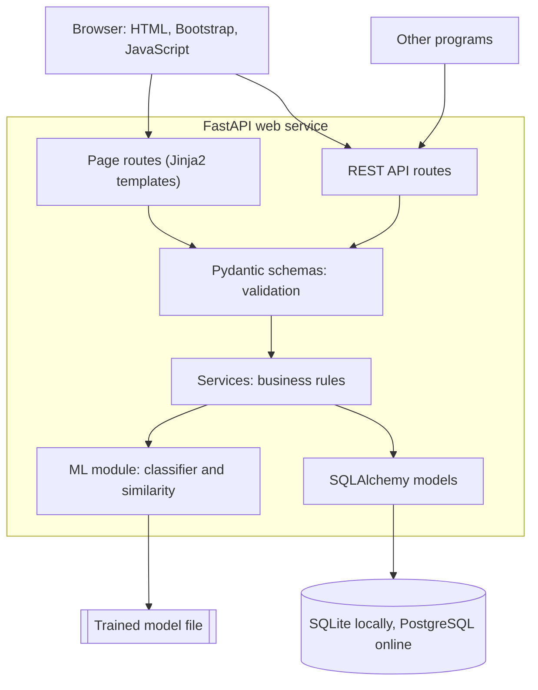

# Architecture

DevInsight AI Lite is one web service, organised in layers. Each layer knows only about the
layer directly beneath it, so a change in one place rarely spreads.

## Responsibilities

| Layer | Knows about | Must not know about |
|---|---|---|
| Routes | HTTP, status codes, templates | SQL, how the model works |
| Schemas | The shape and limits of data | The database, HTTP |
| Services | Business rules | HTTP, HTML |
| Models | Tables and relationships | Business rules, HTTP |
| ML module | Text, vectors, the model file | HTTP, the database |

## Offline and online

Training happens offline on a developer computer. The result is one file, which the service
loads at startup and uses for fast predictions. This is why the service needs no GPU and can
run on a small free server.

## Key decisions

| Decision | Why | What we accept |
|---|---|---|
| One service instead of many | Simple to build, deploy and understand | Everything scales together |
| Server-rendered pages with small scripts | Little code, fast first page, good for learning | Less fluid than a full single-page app |
| TF-IDF and logistic regression | Trains in seconds on a CPU, easy to explain | Understands words, not meaning |
| Signed token in an HttpOnly cookie | The same login works for pages and API | Logout cannot revoke a token elsewhere |
