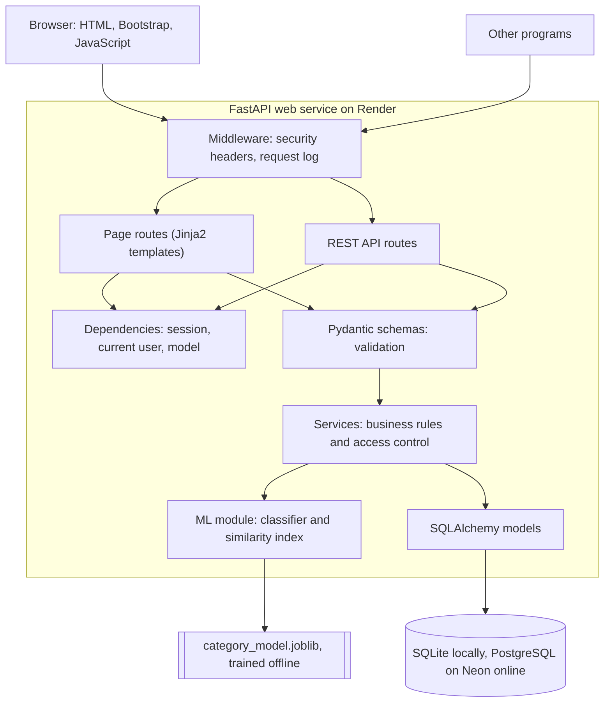

# Architecture summary

DevInsight AI Lite is one web service organised in layers. Each layer knows only about the layer
directly beneath it, so a change in one place rarely spreads.

## Responsibilities

| Layer | Knows about | Must not know about |
|---|---|---|
| Routes | HTTP, status codes, templates | SQL, how the model works |
| Schemas | The shape and limits of data | The database, HTTP |
| Services | Business rules, access rules | HTTP, HTML |
| Models | Tables and relationships | Business rules, HTTP |
| ML module | Text, vectors, the model file | HTTP, the database |

## The path of one request: creating an issue

1. The browser posts the form to `/issues/new`, with the session cookie.
2. Middleware records the start time.
3. FastAPI resolves the dependencies: a database session, the user from the signed cookie, the model.
4. The page route builds an `IssueCreate` schema, which validates every field.
5. The service checks references, asks the model for a suggestion, and saves the issue and the
   suggestion in one transaction.
6. The route answers with a redirect, and the browser asks for the new issue's page.

## Offline and online

Training happens offline on a developer computer. The result is one file, committed with the code,
which the service loads once at startup. This is why the service needs no GPU and can run on a small
free server. The training libraries pandas and matplotlib are not installed on the server at all.

## Key decisions

| Decision | Why | What we accept |
|---|---|---|
| One service instead of many | Simple to build, deploy and understand | Everything scales together |
| Server-rendered pages with small scripts | Little code, fast first page, good for learning | Less fluid than a single-page app |
| TF-IDF and logistic regression | Trains in seconds on a CPU, easy to explain | Understands words, not meaning |
| Suggestions, not decisions | A wrong category costs little when a person confirms it | A person must still look |
| Signed token in an HttpOnly cookie | The same login works for pages and the API | Logout cannot revoke a token elsewhere |
| SQLite locally, PostgreSQL online | Nothing to install, and production-grade online | Differences must be tested on the real database |
| Similarity index in memory | No extra service to run | Rebuilt per worker, suits small data only |
