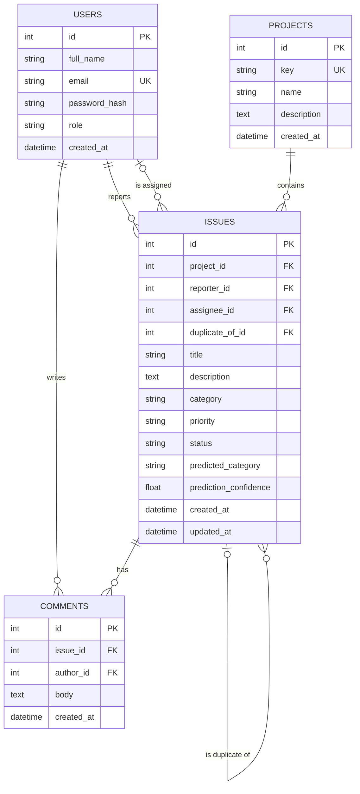

# Entity relationship diagram

## Decisions

- **Category, priority and status are text columns with CHECK constraints**, not separate
  tables. The values rarely change and have no attributes of their own.
- **`assignee_id` may be empty**, because a new issue often has no owner yet.
- **`predicted_category` is stored beside `category`**, so the team can measure how often
  people agree with the model.
- **Deleting an issue deletes its comments**, because a comment has no meaning alone.
- **A project with issues cannot be deleted**, because that would silently destroy history.
